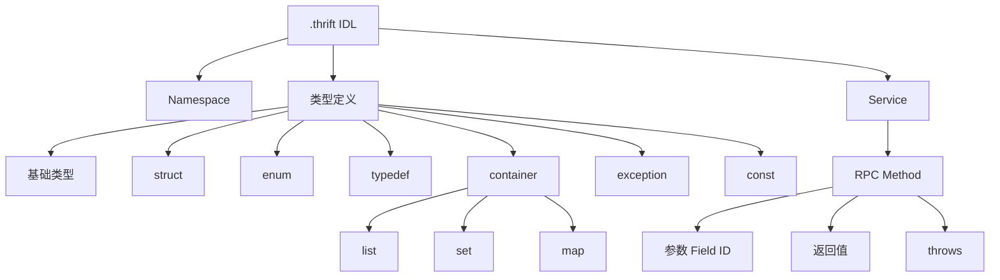

# 概述

Apache Thrift 本质上就是一个“跨语言 RPC 框架 + IDL + 代码生成器”

# IDL



## 完整的 `.thrift`

```thrift
namespace java com.example.user

include "common.thrift"

typedef i64 UserId

const i32 MAX_AGE = 150

enum Gender {
    UNKNOWN = 0,
    MALE = 1,
    FEMALE = 2
}

struct User {
    1: required UserId id
    2: required string name
    3: optional i32 age
    4: optional Gender gender = Gender.UNKNOWN
    5: optional list<string> tags
    6: optional map<string, string> attributes
}

exception UserNotFoundException {
    1: i32 code
    2: string message
}

service UserService {
    User getUser(1: UserId id)
        throws (1: UserNotFoundException e)

    void deleteUser(1: UserId id)

    list<User> queryUsers(
        1: string keyword,
        2: i32 page,
        3: i32 pageSize
    )
}
```
一个 thrift 文件包括：
```
.thrift
├── namespace
├── include
├── typedef
├── const
├── enum
├── struct
├── exception
└── service
```

## namespace：生成代码放在哪里

```java
namespace java com.example.user
// 对应到 Java：
package com.example.user;
```
同一个 `.thrift` 可以给不同语言定义不同 namespace
``` java
namespace java com.example.user
namespace go user
namespace py user
// 对应到
UserService.thrift
       │
       ├── Java → com.example.user
       ├── Go   → user
       └── Python → user
```

## include：引用其他 thrift 文件

```java
// common.thrift
namespace java com.example.common

struct Page {
    1: i32 page
    2: i32 pageSize
}
// user.thrift
include "common.thrift"

struct UserQuery {
    1: common.Page page
    2: string keyword
}
// 相当于
import com.example.common.Page;
```

## typedef：类型别名

```java
typedef i64 UserId
typedef i64 OrderId
typedef string Username

struct User {
    1: UserId id
    2: Username name
}
// 对应 Java
long id;
String name;
```
typedef 并不会创建一种真正全新的序列化类型

## 基础数据类型

| Thrift  | Java    |
| ------- | ------- |
| bool    | boolean |
| byte/i8 | byte    |
| i16     | short   |
| i32     | int     |
| i64     | long    |
| double  | double  |
| string  | String  |
| binary  | byte[]  |

## struct：最重要的数据结构

```java
struct User {
    1: i64 id
    2: string name
    3: i32 age
}
// 对应 Java
class User {
    long id;
    String name;
    int age;
}
```
但是有一个非常重要的区别：前面的数字叫 Field ID，Field ID 是 Thrift IDL 最重要的概念之一；
```java
struct User {
    1: i64 id
    2: string name
}
```
序列化的时候，Thrift 不只是传：
```
id=10086
name=Jayden
```
还会带着字段 ID，不能随便修改 Field ID，Field ID 一旦发布，尽量永久保留，删除字段后，也不要马上复用这个 ID

## required/optional

```java
struct User {
    1: required i64 id
    2: optional string name
}
```
required：必须存在  
optional：可以不存在

## 默认值

```java
struct User {
    1: i64 id
    2: string name = "unknown"
    3: i32 age = 18
}
// 或者
enum Gender {
    UNKNOWN = 0
    MALE = 1
    FEMALE = 2
}
struct User {
    1: Gender gender = Gender.UNKNOWN
}
```

## enum：枚举

```java
enum Gender {
    UNKNOWN = 0
    MALE = 1
    FEMALE = 2
}
```
不要随意改变已经发布的枚举值

## list/set/map

官方定义中，list 是有序集合，set 是不重复集合，map 是唯一 key 到 value 的映射
```java
struct User {
    1: list<string> tags
    2: set<i64> friendIds
    3: map<string, string> attributes
}
```

## const：常量

```java
const i32 MAX_PAGE_SIZE = 100
const string DEFAULT_NAME = "unknown"
```
用于定义 IDL 层面的常量

## exception：RPC 异常

```java
exception UserNotFoundException {
    1: i32 code
    2: string message
}
service UserService {
    User getUser(1: i64 id) throws (1: UserNotFoundException e)
}
```

## service：真正定义 RPC API 的地方

```java
service UserService {
    User getUser(1: i64 id)
    void deleteUser(1: i64 id)
    list<User> queryUsers(
        1: string keyword,
        2: i32 page,
        3: i32 pageSize
    )
}
```

### service 继承

Thrift 支持 service extends
```java
service BaseService {
    string ping()
}
service UserService extends BaseService {
    User getUser(1: i64 id)
}
```

# 参考资料

- [Apache Thrift 软件框架旨在实现可扩展的跨语言服务开发](https://thrift.apache.org/)